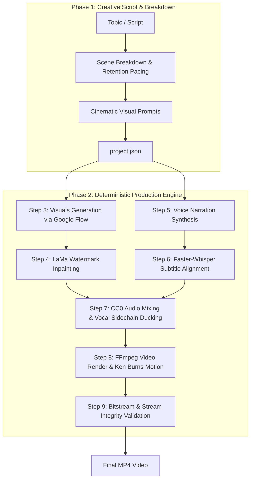

# Scenecraft

Turn a script into a finished vertical or horizontal video: scene breakdown, AI visuals via Google Flow, local narration, word-synced subtitles, mixed audio, and FFmpeg render. Works standalone, with Claude Code, or with Antigravity.


---

## How It Works



---

## Requirements

- **Python:** 3.10+
- **FFmpeg:** Installed and available on system `PATH`
- **Browser:** Google Chrome, Microsoft Edge, or Brave (for Google Flow extension)
- **Hardware:** Optional NVIDIA GPU with NVENC support (falls back automatically to CPU `libx264`)

---

## Quickstart

### Linux & macOS

```bash
git clone https://github.com/your-username/scenecraft.git
cd scenecraft

# Create and activate virtual environment
python3 -m venv .venv
source .venv/bin/activate

# Install package
pip install -e .

# Download models and verify system readiness
scenecraft setup
scenecraft doctor
```

### Windows (PowerShell)

```powershell
git clone https://github.com/your-username/scenecraft.git
cd scenecraft

# Create and activate virtual environment
python -m venv .venv
.venv\Scripts\Activate.ps1

# Install package
pip install -e .

# Download models and verify system readiness
scenecraft setup
scenecraft doctor
```

---

## Usage Modes

### 1. Standalone CLI

Run the full deterministic pipeline directly from a `project.json` file or an example:

```bash
# Run production from a project file
scenecraft make examples/the_rooftop_survivor/project.json

# Or run individual pipeline steps
scenecraft visuals project.json
scenecraft clean path/to/images -o path/to/cleaned
scenecraft narrate project.json
scenecraft subtitles project.json
scenecraft assemble path/to/bundle
scenecraft validate output/video.mp4
```

### 2. Claude Code

Scenecraft includes a packaged skill adapter for Claude Code.

Copy the skill to your Claude Code skills directory:

```bash
mkdir -p ~/.claude/skills
cp -r adapters/claude-code/scenecraft ~/.claude/skills/
```

Claude will handle Steps 1–2 (scene breakdown and prompting) and automatically trigger the Scenecraft CLI for deterministic production.

### 3. Antigravity

Add the Scenecraft workflow rule to your Antigravity agent configuration:

```bash
cp adapters/antigravity/scenecraft_workflow.md ~/.gemini/antigravity/rules/
```

Antigravity will structure story beats and invoke Scenecraft CLI commands or the local MCP server.

---

## Google Flow Extension Setup

Scenecraft generates visual media through Google's Flow tool (`flow.google.com`) using your own active browser session (no API cost).

1. In Chrome, Edge, or Brave, open `chrome://extensions` (or `edge://extensions`).
2. Toggle on **Developer mode** in the top-right corner.
3. Click **Load unpacked**.
4. Select the `extension/dist` folder in this repository.
5. Navigate to [flow.google.com](https://flow.google.com) and sign in.
6. Click the **Scenecraft Flow Connector** icon in your toolbar to activate the side panel.

---

## Configuration

Scenecraft works out-of-the-box with sane defaults. Customize settings by copying the example files:

```bash
cp config.example.yaml config.yaml
cp .env.example .env
```

Key configuration options in `config.yaml`:

```yaml
tts:
  engine: "omnivoice"        # "omnivoice" (port 3900), "edge_tts", or "piper"
  base_url: "http://127.0.0.1:3900"
  voice_id: "6f7af622"
  speed: 0.90

video:
  width: 1080
  height: 1920
  fps: 30
  encoder: "auto"            # "auto" runs a live test encode for NVENC, falls back to libx264
```

---

## Troubleshooting

- **FFmpeg not found:**
  - Linux (Ubuntu/Debian): `sudo apt install ffmpeg`
  - Linux (Arch/CachyOS): `sudo pacman -S ffmpeg`
  - Windows: `winget install Gyan.FFmpeg`
  - macOS: `brew install ffmpeg`
- **NVENC unavailable:** Scenecraft automatically falls back to CPU encoding (`libx264`). To enforce CPU encoding, set `encoder: "libx264"` in `config.yaml`.
- **Extension not connected:** Ensure Google Chrome has `extension/dist` loaded and `flow.google.com` is open in an active tab. Run `scenecraft doctor` to inspect connection state.

---

## Legal & Compliance Disclaimer

> **IMPORTANT NOTICE:**  
> - **Google Flow & Service Terms:** Scenecraft automates interaction with Google Flow through your browser session. Automated access may conflict with Google's Terms of Service. You are solely responsible for ensuring your use complies with applicable terms.
> - **Watermarks & SynthID:** Scenecraft inpaints visible corner preview watermarks for clean rendering. It **does NOT** remove or alter invisible cryptographic SynthID watermarks embedded in generated media. Scenecraft makes no guarantees regarding watermark-free status or platform acceptance.
> - **Licensing & Audio:** Bundled background music and audio sound effects are licensed under Creative Commons Zero (CC0 1.0) Universal / Public Domain. See `assets/licenses.json`.

---

## License

This project is licensed under the [MIT License](LICENSE).
Font assets in `assets/fonts` are licensed under the [SIL Open Font License (OFL)](assets/fonts/LICENSE.txt).
Audio assets in `assets/` are licensed under [CC0 1.0 Universal](assets/licenses.json).
