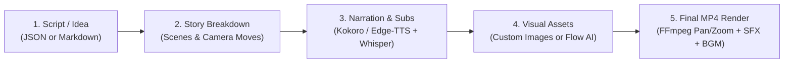

# Scenecraft

Turn a script into a finished video in minutes.

[](https://github.com/Varun1019/Scenecraft/actions/workflows/ci.yml)
[](https://opensource.org/licenses/MIT)
[](https://www.python.org/downloads/)
[](https://github.com/Varun1019/Scenecraft)
[](https://github.com/Varun1019/Scenecraft/releases/latest)

---

## 🎬 30-Second Overview

**What you give it:** A story premise, bullet outline, or scene-by-scene script.  
**What it does:** Breaks the story into retention-tuned visual beats, synthesizes natural voiceover, extracts word timings with Whisper, burns non-overlapping subtitles, and mixes royalty-free audio.  
**What you get:** A broadcast-ready vertical short (9:16) or widescreen video (16:9) ready to publish.


---

## ✨ Why Scenecraft?

- ⚡ **Zero-Setup Quickstart:** Run `scenecraft demo` immediately after cloning to render a 10-second vertical video 100% offline. Zero accounts, zero API keys, zero network required.
- 🎙 **Pluggable Voiceover:** Choose between offline local neural TTS ([Kokoro-82M](https://github.com/thewh1teagle/kokoro-onnx), Piper), zero-setup cloud neural (Edge-TTS), local voice clones (OmniVoice), or cinematic paid APIs (ElevenLabs, OpenAI).
- 🎨 **Visual Flexibility:** Feed your own custom images via `--images-dir` or connect directly to Google Flow (`flow.google.com`) in your browser for free AI image and video generation.
- ⏱ **Voice-First Subtitles:** Narration sets the source of truth for duration. Faster-Whisper automatically aligns word-by-word karaoke subtitles with guaranteed zero visual overlap.
- 🎵 **YouTube Monetization Safe:** Bundled ambient background music and sound effects are certified CC0 1.0 Universal / Public Domain.
- 🔄 **Smart Pipeline Resume:** Step-by-step state tracking (`.scenecraft_state.json`) lets you re-run without re-rendering completed visual or audio assets.

---

## 🏗 How It Works



> For the detailed 9-step production lifecycle and quality gates, see [docs/workflow.md](docs/workflow.md).

---

## 🎙 Choose Your Voiceover

Scenecraft supports six voice engines with automatic fallback:

| Engine | Type | Cost | Setup | Offline? | Best For |
|---|---|---|---|:---:|---|
| **Kokoro-82M** | Local ONNX Neural | Free (Apache 2.0) | `scenecraft setup --tts kokoro` (~108 MB) | **Yes** | Fast, high-quality offline production on CPU/GPU |
| **Edge-TTS** | Cloud Neural | Free | Zero setup (`pip install edge-tts`) | No | Instant natural voices with zero model downloads |
| **OmniVoice** | Local Daemon | Free | VoiceStudio daemon on `localhost:3900` | **Yes** | Custom voice-cloned narrator profiles |
| **Piper** | Local Neural | Free (MIT) | `scenecraft setup --tts piper` | **Yes** | Lightweight embedded synthesis |
| **ElevenLabs** | Paid Cloud API | Paid per char | Set `ELEVENLABS_API_KEY` in `.env` | No | Hollywood-grade cinematic narration |
| **OpenAI** | Paid Cloud API | Paid per char | Set `OPENAI_API_KEY` in `.env` | No | Standard OpenAI `alloy`, `echo`, `nova` voices |

> 💡 **No VoiceStudio or GPU? No problem.** Kokoro-82M and Edge-TTS work straight out of the box on standard laptops without special hardware or paid subscriptions.

Inspect and preview available voices at any time:
```bash
scenecraft voices
scenecraft voices --preview kokoro --voice af_heart
```

---

## 🚀 Quickstart

### Option A: Windows (PowerShell)

Open PowerShell and run:

```powershell
# 1. Ensure execution policy allows virtual environments
Set-ExecutionPolicy -Scope CurrentUser RemoteSigned

# 2. Clone and enter repo
git clone https://github.com/Varun1019/Scenecraft.git
cd Scenecraft

# 3. Create venv and install Scenecraft
python -m venv .venv
.\.venv\Scripts\Activate.ps1
pip install -e .

# 4. Check system diagnostics
scenecraft doctor

# 5. Render your first video (100% offline demo, <15 seconds)
scenecraft demo
```

**Expected output:**
```text
🎬 SCENECRAFT QUICKSTART DEMO (100% Offline)
[1/3] Loading bundled narration audio & word-synced subtitles...
[2/3] Linking demo scene illustrations and licensed SFX/BGM...
[3/3] Assembling complete MP4 video via FFmpeg (Pan/Zoom + SFX + BGM + Subs)...
🎉 DEMO VIDEO CREATION SUCCESSFUL!
File Path: output\demo\demo_video.mp4 (10.00s, 1080x1920)
```

*(Missing FFmpeg or Python on Windows? Run `winget install Gyan.FFmpeg Python.Python.3.12 Git.Git`, then restart PowerShell. See [docs/WINDOWS_TEST_CHECKLIST.md](docs/WINDOWS_TEST_CHECKLIST.md) for a verification walk-through.)*

---

### Option B: Linux & macOS (Bash)

```bash
# 1. Clone repository
git clone https://github.com/Varun1019/Scenecraft.git
cd Scenecraft

# 2. Create venv and install
python3 -m venv .venv
source .venv/bin/activate
pip install -e .

# 3. Check environment
scenecraft doctor

# 4. Render 100% offline demo video
scenecraft demo
```

*(On Ubuntu/Debian: `sudo apt install ffmpeg`. On Arch/CachyOS: `sudo pacman -S ffmpeg`. On macOS: `brew install ffmpeg`.)*

---

## 🛠 Make Your First Custom Video

### Path 1: Using Your Own Images (100% Offline)

Scaffold a fresh story project:
```bash
scenecraft init my_first_story
cd my_first_story
```

Place 3 illustrations or photos into `images/` (`scene_01.jpg`, `scene_02.jpg`, `scene_03.jpg`), then render:
```bash
scenecraft make project.json --images-dir images/
```
Scenecraft will synthesize narration, sync subtitles, apply cinematic camera motion, and mix background audio into `output/`.

---

### Path 2: Free Visuals with Google Flow in Your Browser

1. Open Chrome and visit `chrome://extensions`.
2. Toggle **Developer mode** (top right) ON.
3. Click **Load unpacked** and select the `extension/` folder inside Scenecraft.
4. Log into [flow.google.com](https://flow.google.com) in Chrome.
5. In your terminal:
```bash
scenecraft status   # Shows: Google Flow: CONNECTED
scenecraft make project.json
```
Flow generates the scene artwork through your browser session with zero API costs.

---

## 💻 CLI Commands Cheat Sheet

| Command | Description | Example |
|---|---|---|
| `scenecraft demo` | Render a 10s offline test video | `scenecraft demo [--live-tts]` |
| `scenecraft init <name>` | Scaffold a new story project | `scenecraft init dark_bunker` |
| `scenecraft make <file>` | Run deterministic video pipeline | `scenecraft make project.json [--images-dir img/]` |
| `scenecraft setup` | Download local models (LaMa, Kokoro, Whisper) | `scenecraft setup --tts kokoro` |
| `scenecraft voices` | List and preview narrator voices | `scenecraft voices --preview kokoro` |
| `scenecraft doctor` | Run preflight hardware and tool diagnostics | `scenecraft doctor [--report]` |
| `scenecraft report` | Print sanitized Markdown report for GitHub issues | `scenecraft report` |
| `scenecraft clean` | Inpaint corner watermarks with LaMa ONNX | `scenecraft clean raw.jpg -o clean.jpg` |
| `scenecraft status` | Inspect Flow connection and audio licenses | `scenecraft status` |

---

## 🤖 Using with AI Agents

### Claude Code
Install the Scenecraft skill adapter:
```bash
mkdir -p ~/.claude/skills
cp -r adapters/claude-code/scenecraft ~/.claude/skills/
```
Ask Claude Code: *"Create a 3-scene vertical short about a deep sea expedition using Scenecraft."*

### Google Antigravity
Link the workflow directives into your local Antigravity configuration:
```bash
cp adapters/antigravity/scenecraft_workflow.md ~/.gemini/antigravity/rules/
```

---

## ❓ Frequently Asked Questions

<details>
<summary><b>Is Scenecraft free?</b></summary>

Yes. Scenecraft is open-source under the MIT license. Generating images via Google Flow uses your browser session with free tier limits. Offline models (Kokoro, Faster-Whisper, LaMa) run locally at zero cost.
</details>

<details>
<summary><b>Do I need an NVIDIA GPU?</b></summary>

No. If NVENC is available, Scenecraft uses hardware encoding (`h264_nvenc`). If not, it automatically switches to CPU encoding (`libx264`). The offline demo and custom video rendering run smoothly on standard laptop CPUs.
</details>

<details>
<summary><b>Can I resume an interrupted render?</b></summary>

Yes. Scenecraft creates a `.scenecraft_state.json` file inside the project output folder. Re-running `scenecraft make project.json` automatically skips completed steps. Use `--force` to re-run from scratch.
</details>

<details>
<summary><b>Does it work without internet?</b></summary>

Yes. With Kokoro TTS or pre-recorded audio and local images, the entire rendering, subtitle alignment, and FFmpeg assembly pipeline runs 100% offline.
</details>

<details>
<summary><b>Does Scenecraft bypass or remove cryptographic SynthID?</b></summary>

No. Scenecraft only inpaints visible corner preview watermarks for clean framing. It **never** alters or bypasses invisible cryptographic SynthID watermarks embedded by AI generators.
</details>

---

## 🐛 Something Broke?

We want to hear from you! To report a bug without leaking private data:

1. Run the sanitized diagnostic report:
   ```bash
   scenecraft report
   ```
2. Copy the generated Markdown block (home directory, username, API keys, and tokens are scrubbed automatically).
3. Open a ticket:
   - 🐛 [Report a Bug](https://github.com/Varun1019/Scenecraft/issues/new?template=bug_report.yml)
   - 💡 [Request a Feature](https://github.com/Varun1019/Scenecraft/issues/new?template=feature_request.yml)
   - 💬 [Ask a Question in Discussions](https://github.com/Varun1019/Scenecraft/discussions)
   - 📖 [Read the Troubleshooting Guide](docs/TROUBLESHOOTING.md)

---

## 🗺 Roadmap

- [x] Script-to-video deterministic assembly pipeline
- [x] 100% offline quickstart demonstration (`scenecraft demo`)
- [x] Pluggable TTS with Kokoro-82M ONNX, Edge-TTS, and runtime fallback
- [x] Faster-Whisper non-overlapping word-level subtitle alignment
- [x] Custom image directory ingestion (`--images-dir`) and resume state file
- [x] Google Flow extension bridge with local token pairing
- [x] Automated privacy-safe diagnostic reporting (`scenecraft report`)
- [ ] Direct export to SRT and VTT subtitle sidecars
- [ ] Multi-character dialogue pacing for 2-voice scripts
- [ ] Web-based visual storyboard editor

---

## 📄 License & Attribution

- Scenecraft source code is released under the [MIT License](LICENSE).
- Bundled Noto Sans font is licensed under the [SIL Open Font License](assets/fonts/LICENSE.txt).
- Background music and sound effects are certified [CC0 1.0 Universal / Public Domain](assets/licenses.json).
- See [THIRD_PARTY_NOTICES.md](THIRD_PARTY_NOTICES.md) for external model licenses (Kokoro-82M, LaMa, Whisper).
