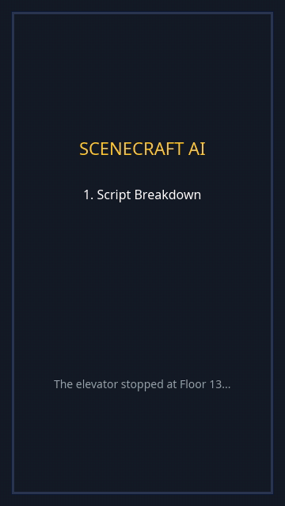
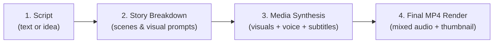

# Scenecraft

Turn a script into a finished video.

[](https://github.com/Varun1019/Scenecraft/actions/workflows/ci.yml)
[](https://opensource.org/licenses/MIT)
[](https://www.python.org/downloads/)
[](https://github.com/Varun1019/Scenecraft/releases/latest)

---

## What It Is

**What you give it:** A story topic, a bulleted outline, or a finished script.  
**What it does:** Breaks the story into scenes, generates visual prompts, creates voice narration, aligns word-by-word subtitles, and mixes audio.  
**What you get:** A finished vertical short (9:16) or widescreen video (16:9) ready to publish.



<!-- Longer showcase video placeholder: upload your demo MP4/WebM to GitHub release assets or YouTube and embed link below -->
<!-- [](https://github.com/Varun1019/Scenecraft/releases/download/v0.1.0/showcase_demo.mp4) -->

---

## What It Does

- 🎬 **Scene planning:** Breaks stories into visual beats with pacing tuned for viewer retention.
- 🎨 **Visual acquisition:** Connects to Google Flow in your browser to generate high-resolution cinematic artwork with consistent character styles.
- 🎙️ **Voice narration:** Synthesizes narration using local neural engines or instant zero-setup cloud voices.
- 📝 **Word-synced subtitles:** Uses Faster-Whisper to extract word timings and burns clean, non-overlapping karaoke-style subtitles.
- 🎵 **Royalty-free audio:** Mixes certified CC0 ambient music and Foley sound effects with automatic voice ducking.
- 📦 **Automated packaging:** Renders the final MP4 with hardware acceleration, verifies stream health, and designs an independent thumbnail.

---

## How It Works in 60 Seconds



Scenecraft uses a hybrid model: you or an AI agent write the story, and the local pipeline deterministically handles rendering, subtitles, audio levels, and video encoding.

> For the detailed 9-step technical breakdown, see [docs/workflow.md](docs/workflow.md).

---

## Quickstart

### Option 1: Linux & macOS

```bash
git clone https://github.com/Varun1019/Scenecraft.git
cd Scenecraft

python3 -m venv .venv
source .venv/bin/activate
pip install -e .

scenecraft setup
scenecraft doctor
```

### Option 2: Windows (PowerShell)

```powershell
git clone https://github.com/Varun1019/Scenecraft.git
cd Scenecraft

python -m venv .venv
.venv\Scripts\Activate.ps1
pip install -e .

scenecraft setup
scenecraft doctor
```

### Option 3: Arch Linux / CachyOS

```bash
sudo pacman -S ffmpeg git python
git clone https://github.com/Varun1019/Scenecraft.git
cd Scenecraft

python3 -m venv .venv
source .venv/bin/activate
pip install -e .

scenecraft setup
scenecraft doctor
```

### Make Your First Video in 3 Steps

Render a bundled sample video without needing extra accounts:

```bash
# 1. Run full assembly from an example project
scenecraft make examples/the_rooftop_survivor/project.json

# 2. Check the output folder
ls -lh output/the_rooftop_survivor/

# 3. Validate video decode health
scenecraft validate output/the_rooftop_survivor/the_rooftop_survivor.mp4
```

---

## Three Ways to Use It

### 1. Standalone CLI
Generate stories, plan scenes, and render videos directly from your terminal:

```bash
# Plan a standalone story without spending image generation quota
scenecraft plan --title "The Locked Basement"

# Run end-to-end production
scenecraft run --title "The Locked Basement"
```

### 2. With Claude Code
Use Scenecraft as an agent skill inside Claude Code. Claude handles creative outlining and prompts, then calls Scenecraft to render:

```bash
# Install skill adapter into your Claude Code config
mkdir -p ~/.claude/skills
cp -r adapters/claude-code/scenecraft ~/.claude/skills/
```

### 3. With Antigravity
Pair Scenecraft with Google Antigravity for conversational video directing:

```bash
# Copy workflow directive to Antigravity rules
cp adapters/antigravity/scenecraft_workflow.md ~/.gemini/antigravity/rules/
```

---

## What You Need

| Component | Required? | Purpose |
| :--- | :---: | :--- |
| **Python 3.10+** | Yes | Runs the pipeline and CLI commands |
| **FFmpeg & FFprobe** | Yes | Video concatenation, audio ducking, subtitle burn-in |
| **Edge-TTS** | Default | Instant zero-setup speech synthesis (included) |
| **Chrome / Edge / Brave** | Optional | Required only if generating AI images through Google Flow |
| **NVIDIA GPU** | Optional | Accelerates video encoding (`h264_nvenc`). Falls back to CPU (`libx264`) automatically |
| **OmniVoice / Local TTS** | Optional | High-fidelity offline voice daemon on `http://127.0.0.1:3900` |

---

## The Chrome Extension

Scenecraft includes a browser extension that connects the local CLI to Google Flow (`flow.google.com`) so you can generate visuals using your existing browser session:

1. **Download:** Download `Scenecraft-flow-connector-v0.1.0.zip` from [Releases](https://github.com/Varun1019/Scenecraft/releases/latest) (or use the unbuilt `extension/` directory).
2. **Open Extensions:** In Chrome, Edge, or Brave, visit `chrome://extensions` and turn on **Developer mode** in the top-right corner.
3. **Load:** Click **Load unpacked** and select the extension folder.
4. **Sign In & Pair:** Navigate to [flow.google.com](https://flow.google.com). The extension connects to Scenecraft on `127.0.0.1:8795` using a local authentication token (`bridge_token.json`).

---

## Frequently Asked Questions

<details>
<summary><b>Is Scenecraft free to use?</b></summary>

Yes. The engine, subtitle tools, audio mixer, and CLI are 100% open-source under the MIT license. Generating images via Google Flow uses your browser session with free tier limits.
</details>

<details>
<summary><b>Do I need a dedicated GPU?</b></summary>

No. If an NVIDIA GPU with NVENC is available, Scenecraft uses hardware encoding for fast renders. If not, it automatically switches to CPU encoding (`libx264`).
</details>

<details>
<summary><b>Which voices are supported?</b></summary>

By default, Scenecraft uses Microsoft Edge neural voices (high quality, zero setup, multilingual). If you run OmniVoice or a local Kokoro TTS daemon on port 3900, Scenecraft automatically uses it for offline production.
</details>

<details>
<summary><b>Does it work offline?</b></summary>

Yes. With a pre-written `project.json` and local audio, the entire rendering, subtitle alignment (Faster-Whisper), and FFmpeg assembly pipeline runs completely offline.
</details>

<details>
<summary><b>Which operating systems are supported?</b></summary>

Linux (Ubuntu, Debian, Arch, CachyOS, Fedora) and Windows (10, 11) are tested in continuous integration. macOS is supported via standard POSIX paths and Homebrew dependencies.
</details>

<details>
<summary><b>Why is edge-tts the default?</b></summary>

It requires no API keys, no local GPU memory, and sounds natural out-of-the-box. You can change your preferred voice in `config.yaml`.
</details>

<details>
<summary><b>Can I use my own images or video clips?</b></summary>

Yes. Place your images or video clips into your project's `images/` directory and run `scenecraft make project.json`.
</details>

<details>
<summary><b>What does "experimental on Windows" mean?</b></summary>

All 100+ unit tests and E2E renders pass on Windows in CI. However, variations in PowerShell execution policies, console encodings, and path quoting across different Windows versions may cause minor quirks. If you spot one, please report it!
</details>

---

## Known Limits and Honest Notes

- **Platform Support:** Ubuntu and Arch Linux are tier-1 tested. Windows support is actively validated in CI and considered experimental.
- **Google Flow Automation:** The extension automates user actions in your browser. Always ensure your use complies with Google's Terms of Service.
- **Watermarks & SynthID:** Scenecraft inpaints visible corner preview watermarks for clean rendering. It **does NOT** remove invisible cryptographic SynthID watermarks embedded by AI image generators.
- **Credit Safety:** Scenecraft defaults to dry-run mode and will not consume Flow generation quota without confirmation.

---

## Something Broke or Have an Idea?

We want to hear from you! To get help quickly without accidentally exposing private info:

1. Run the safe report command:
   ```bash
   scenecraft report
   ```
2. Copy the output (personal paths, emails, usernames, and tokens are scrubbed automatically).
3. Open a ticket:
   - 🐛 [Report a Bug](https://github.com/Varun1019/Scenecraft/issues/new?template=bug_report.yml)
   - 💡 [Request a Feature](https://github.com/Varun1019/Scenecraft/issues/new?template=feature_request.yml)
   - 💬 [Ask a Question in Discussions](https://github.com/Varun1019/Scenecraft/discussions)
   - 📖 [Read the Troubleshooting Guide](docs/TROUBLESHOOTING.md)

---

## Roadmap

- [x] Script-to-video deterministic assembly pipeline
- [x] Faster-Whisper automatic subtitle alignment with zero overlaps
- [x] Google Flow extension bridge with local token pairing
- [x] Automated privacy-safe diagnostic reporting (`scenecraft report`)
- [ ] Direct export to SRT / VTT subtitle tracks
- [ ] Multi-voice dialogue support for two-character scripts
- [ ] Browser-based interactive story review canvas

---

## Contributing

Contributions are welcome! Please read [CONTRIBUTING.md](CONTRIBUTING.md) and our [Code of Conduct](CODE_OF_CONDUCT.md) before submitting pull requests.

⭐ **If you find Scenecraft useful, star this repository on GitHub!**

---

## License & Credits

- Scenecraft source code is released under the [MIT License](LICENSE).
- Bundled Montserrat and Noto Sans fonts are licensed under the [SIL Open Font License](assets/fonts/LICENSE.txt).
- Background tracks and sound effects are certified [CC0 1.0 Universal / Public Domain](assets/licenses.json).
