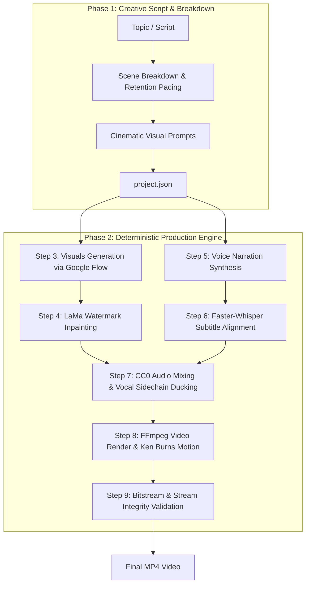

# Scenecraft Production Workflow

Scenecraft implements a 9-step hybrid production pipeline where creative writing is performed by an AI agent (or human) and deterministic media synthesis is handled by the local engine.

---

## Detailed Step Specification

### 1. Scene Breakdown & Narrative Pacing
- The calling agent breaks the user's premise into 15–45 visual beats.
- Retention hooks are placed in the first 3 seconds to maximize short-form viewer retention.

### 2. Prompt Engineering
- Image prompts adhere to cinematic lighting, composition, and consistent character anchor descriptions.
- Output is written to `project.json`.

### 3. Visuals Generation
- The `scenecraft visuals` command dispatches prompts to Google Flow via the Scenecraft Flow Connector extension.
- Generated 2K/1080p images are saved to the bundle image directory.

### 4. Watermark Inpainting
- The `scenecraft clean` command applies a local LaMa ONNX model to inpaint visible corner watermarks cleanly.

### 5. Voice Narration Synthesis
- Synthesizes spoken audio using OmniVoice (local daemon on port 3900) or zero-setup Edge-TTS fallback.

### 6. Subtitle Alignment
- Faster-Whisper extracts word-level timestamps from the narration audio.
- Renders karaoke-style word-highlighted ASS subtitles bundled with open-licensed fonts.

### 7. Audio Mixing & Ducking
- Validates all SFX and background music against CC0 public-domain licenses in `assets/licenses.json`.
- Dynamically ducks background music by -14 LUFS during vocal narration passages.

### 8. Video Assembly
- Normalizes all media to 30 fps using hardware-accelerated NVENC or CPU libx264 fallback.
- Applies subtle 2.5D Ken Burns zoom, pan, and transition effects.

### 9. Stream Validation
- Decodes the finished MP4 with FFprobe/FFmpeg to guarantee zero bitstream corruption before completion.
